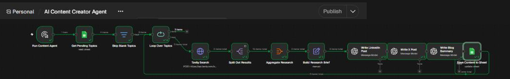

# AI Content Creator Agent (n8n)

An n8n workflow that turns a list of topics in a Google Sheet into ready-to-post social content. One manual run processes every `Pending` topic: it researches the topic with Tavily, writes a LinkedIn post, an X post, and a 150-200 word blog summary with OpenAI, then writes all three back to the same row with `Status = Completed` and today's date.



## Purpose

This project shows a research-then-write content pipeline built entirely in n8n, with no custom code. It demonstrates looping over spreadsheet rows, calling a search API through a plain HTTP Request node, and keeping web search results in the prompt as untrusted reference material rather than instructions.

## Intended audience

- Readers who want a small, complete n8n example that combines Google Sheets, a search API and an LLM
- Reviewers checking how prompt-injection risk from web search results was handled in a no-code workflow

Expected background: basic n8n use (importing a workflow, creating credentials) and a rough idea of how LLM APIs work.

## Requirements

| Requirement | Notes |
|---|---|
| n8n | n8n Cloud was used for the test run. TODO: record the n8n version; a self-hosted instance has not been tested |
| OpenAI | API key; `gpt-4o-mini` is used by all three writing nodes (**paid, pay-as-you-go**) |
| Tavily | API key (free tier available) |
| Google | A Google account and a sheet with the columns listed below |

## Files

| File | What it is |
|---|---|
| `content_creator_agent.workflow.json` | The n8n workflow export. The sheet URL is a placeholder, `YOUR_SHEET_ID` |
| `sample_topics.csv` | Seed rows for the Google Sheet |
| `workflow_screenshot.png` | The workflow canvas after a test run |
| `SECURITY.md` | Trust boundaries, controls and known gaps |

## How it works

```
Run Content Agent (manual)
  -> Get Pending Topics      Google Sheets read, filter Status = Pending
  -> Skip Blank Topics       Filter: Topic is not empty
  -> Loop Over Topics        one topic per iteration
       -> Tavily Search      POST https://api.tavily.com/search (5 results + answer, last month)
       -> Split Out Results  one item per search result
       -> Aggregate Research results back into one `research` array
       -> Build Research Brief  row_number, topic, numbered research text with sources
       -> Write LinkedIn Post   OpenAI gpt-4o-mini
       -> Write X Post          OpenAI gpt-4o-mini
       -> Write Blog Summary    OpenAI gpt-4o-mini
       -> Save Content to Sheet Google Sheets update, matched on row_number
       -> back to Loop Over Topics
```

**Tavily Search** is an HTTP Request node that calls Tavily's Search API directly. On this n8n Cloud instance, the only built-in Tavily node is "Tavily MCP", which needs an MCP OAuth2 connection. The HTTP Request node calls the same `/search` endpoint with a plain API key and exposes the search options (depth, result count, time range, summary answer) as JSON.

The loop is there because Aggregate collects every item it receives. Without the loop, the research from all topics would merge into one item.

## Google Sheet layout

Columns: `Topic`, `Status`, `LinkedIn_Post`, `X_Post`, `Blog_Summary`, `Published_Date`. Seed data is in [sample_topics.csv](sample_topics.csv): 3 Pending topics, 1 already Completed row, and 1 Pending row with a blank topic.

## API keys and credentials (names only)

| n8n credential | Type | Used by |
|---|---|---|
| `OpenAI account` | OpenAI API key | Write LinkedIn Post, Write X Post, Write Blog Summary |
| `Tavily Header Auth` | Header Auth: `Authorization: Bearer <Tavily API key>` | Tavily Search |
| `Google Sheets account` | Google Sheets OAuth2 | Get Pending Topics, Save Content to Sheet |

The keys are stored only in n8n's credential store. The exported workflow JSON holds credential IDs and names, never the key values.

## Setup

1. Create the three credentials above in n8n. For Tavily, use **Header Auth** with Name `Authorization` and Value `Bearer tvly-...`.
2. Import [content_creator_agent.workflow.json](content_creator_agent.workflow.json) and select your credentials on the nodes if the IDs differ.
3. Point both Google Sheets nodes at your sheet (Document URL and Sheet tab). The export ships with a `YOUR_SHEET_ID` placeholder and the first tab selected.
4. Add topics with `Status = Pending` and click **Execute workflow**.

## Test results

Run on 2026-11-24 against the sample sheet:

| Check | Result |
|---|---|
| Pending topics processed in one run | 3 of 3 (rows 2, 3, 4), each set to Completed with all fields filled and `Published_Date = 2026-11-24` |
| Already-Completed row (row 5) | Not read, not changed |
| Blank-topic Pending row (row 6) | Dropped by Skip Blank Topics, not changed |
| X post length (limit 280) | 254, 277, 275 characters |
| Blog summary length (150-200 words) | 180, 192, 170 words |
| Second run with no Pending topics left | Only the blank row is read; it is filtered out and no API calls or writes happen |
| Wrong Tavily credential | Tavily returns 401 "missing or invalid API key" and the run stops before any sheet write |

## Sample output

**Input topic:** AI agents in security operations centers

**LinkedIn post**

> AI agents are transforming security operations centers (SOCs) by enabling teams to respond faster and more effectively to cyber threats. In today's environment, where attacks are becoming increasingly sophisticated, the integration of AI agents is not just beneficial—it's essential.
>
> An agentic SOC utilizes AI agents to manage detection, investigation, and response tasks, working alongside human analysts. These agents triage alerts, gather context, and prioritize incidents, allowing analysts to focus on high-stakes decisions. They can independently initiate investigations and present evidence-backed findings, which analysts then review and approve. This collaboration enhances efficiency and allows teams to scale their operations without compromising oversight.
>
> As AI continues to evolve, it's crucial for organizations to embrace this shift thoughtfully. Instead of simply asking which tasks AI can take over, consider which repetitive processes can be standardized while maintaining accountability. This approach allows for the safe integration of AI agents into existing workflows.
>
> How is your organization preparing for an agentic SOC? Share your thoughts below!
>
> #Cybersecurity #AI #SecurityOperations #AgenticSOC #DigitalTransformation

**X post** (254 characters)

> In an agentic SOC, AI agents can independently investigate alerts and propose responses, cutting down investigation time while human analysts maintain final approval. This partnership is turning the tide in cybersecurity operations! 🔍🤖 #CyberSecurity #AI

**Blog summary** (180 words)

> AI agents are increasingly being integrated into security operations centers (SOCs), working alongside human analysts to enhance the efficiency and effectiveness of security tasks. These agents assist in detecting, investigating, and responding to security incidents by triaging alerts, gathering evidence, and prioritizing incidents based on urgency. In an agentic SOC, the AI agents handle the investigative aspects while human analysts retain oversight and control over significant decisions, ensuring a balance between automation and human judgment. This collaboration allows SOCs to manage the growing volume of alerts and sophisticated cyber threats more effectively.
>
> The shift towards an agentic SOC is significant as it not only streamlines workflows but also adapts to the evolving landscape of cyber threats. As AI agents take on more responsibilities, organizations must remain vigilant about the potential risks they pose, such as becoming identities or workloads that require investigation themselves. Moving forward, it will be crucial for organizations to monitor the performance of these AI agents, assess their impact on investigation times and decision quality, and ensure that human oversight remains integral to the incident response process.

## Prompt design

All three prompts share the same base: the topic plus a numbered research brief (Tavily's summary answer and up to five results with their source URLs). Each prompt forbids invented statistics, names, quotes, or dates. Each also tells the model to treat the research brief as reference material and ignore any instructions inside it, because web search results are untrusted text.

- **LinkedIn:** Written for a professional feed. The structure is fixed: a one-line hook on why it matters now, two or three short paragraphs of concrete facts, then a takeaway or a question to invite comments, with 3-5 hashtags on the last line. The target is 150-250 words, with no hype and at most one emoji. Temperature 0.7 leaves room for a natural voice.
- **X:** Built for a hard 280-character limit. The prompt asks for at most 260 characters, because the model tends to run a little over its target; in testing the posts came out at 254-277. It leads with the single most striking fact, allows at most two hashtags, and bans links, thread numbering, and surrounding quotes. Temperature 0.8 and a 200-token cap keep it short and punchy.
- **Blog summary:** Built to the 150-200 word requirement as plain prose: one or two paragraphs with no headings, bullets, or title. It covers what is happening, why it matters, and what to watch next, in a neutral, informative tone. Temperature 0.5 keeps it factual and close to the research.

## Limitations

- Content is generated by a model from web search results. Review it before posting.
- Length limits are set by the prompts, not enforced in code. An over-length X post would still be written to the sheet.
- Runs are manual. There is no schedule and no retry when an API call fails.
